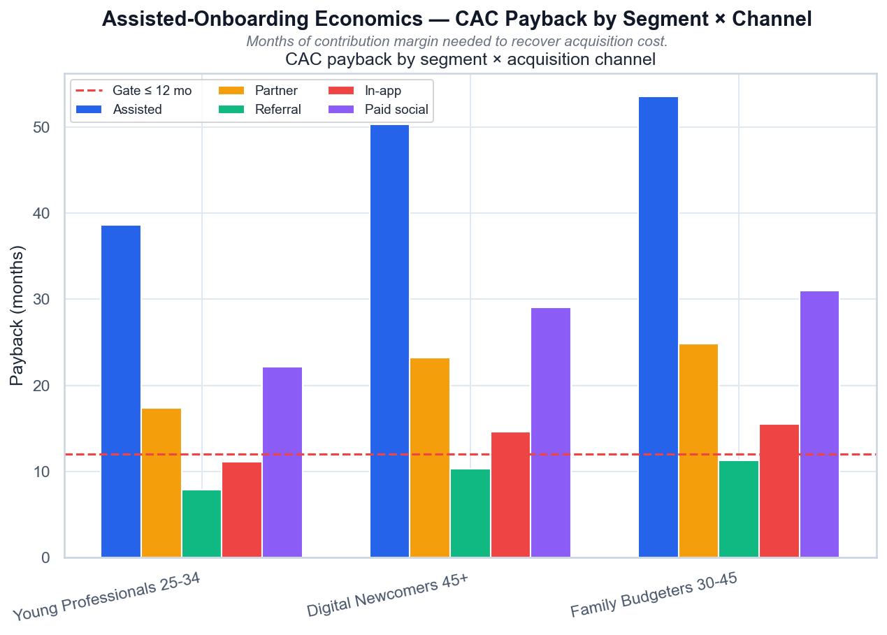

# Volta — Assisted CAC vs LTV

[](https://github.com/NikitaBoyarkin/case-assisted-cac/actions/workflows/ci.yml)

[](LICENSE)

Does the 45+ trust track pay off: 45+ LTV/CAC = 0.66 against a ≥3 gate; assisted CAC €120 is ~3× referral and doesn't pay back (50-month payback).

## Navigation

- 📖 [Full case study on the portfolio site](https://nikitaboyarkin.github.io/en/projects/volta/assisted-cac/)
- 🏦 [Parent project: volta-banking](https://github.com/NikitaBoyarkin/volta-banking)
- 🧪 Related cases: [anchor-cac](https://github.com/NikitaBoyarkin/case-anchor-cac) · [attribution](https://github.com/NikitaBoyarkin/case-attribution)

**On this page:** [Key results](#key-results) · [Situation](#situation) · [Task](#task) · [Actions](#actions) · [Result](#result) · [Recommendations](#recommendations) · [Charts](#charts) · [Dataset](#dataset) · [Quick start](#quick-start)

## Key results

- 45+ LTV/CAC 0.66 (gate ≥3)
- Anchor clears 3.62 only via referral
- Assisted CAC €120; 50-month payback

## Situation

The first RAT v2 validation project: the v1 recommendation 'a separate trust track for 45+' is tested in money.

## Task

I owned the first check in the validation round that put the earlier recommendation — a separate trust track for the senior segment — to a money test.

## Actions

- LTV per user (ARPU × contribution margin × retention months).
- Blended CAC by segment × channel, LTV/CAC with bootstrap CIs, payback.
- Welch t-test anchor vs 45+ on assisted LTV.

## Result

- The **anchor** clears the ≥3 gate only via referral: LTV/CAC **3.62**.
- **45+** clears no channel: assisted **0.41**; blended 45+ **0.66**.
- Assisted gives the best retention (churn ×0.75), but the €120 CAC outweighs it — **50-month payback**.
- Welch t-test: anchor − 45+ = **€43.99** (p≈2e-13).

## Recommendations

- The v1 'trust track' is right in direction but not yet affordable — hold.
- Cut assisted CAC (remote video KYC, partner cost-sharing).
- Combine with a 45+ monetization lever before scaling.

## Charts


> # Assisted-Onboarding Economics — LTV/CAC by Segment × Channel
>
> 
>
> *LTV/CAC по сегментам и каналам привлечения; красная линия — гейт ≥ 3,0.*
>
> ## Выводы
>
> - Якорь (Young Professionals) проходит гейт только через реферал: LTV/CAC 3,62.
> - 45+ (Digital Newcomers) не проходит гейт ни на одном канале: assisted 0,41 — в 3 раза ниже порога.
> - Assisted-онбординг даёт лучший retention (churn ×0,75), но CAC €120 перекрывает этот выигрыш на 45+.
> - Вывод: рекомендация «отдельный trust-трек для 45+» не окупается при текущем CAC — нужен более дешёвый доверительный канал.
>
> ---
> <sub>Источник: `scripts/volta_assisted_cac.py` · данные: `data/volta_assisted_cac.csv`</sub>



> # Assisted-Onboarding Economics — CAC Payback by Segment × Channel
>
> 
>
> *Срок окупаемости CAC (месяцы) по сегментам и каналам; гейт ≤ 12 мес.*
>
> ## Выводы
>
> - Реферал окупается быстрее всего во всех сегментах (низкий CAC + хороший retention).
> - Assisted для 45+ окупается за 50 мес — в 4 раза дольше гейта.
> - Paid social — худший канал и по CAC, и по retention: самый долгий payback.
> - Только реферал якоря укладывается в гейт ≤ 12 мес.
>
> ---
> <sub>Источник: `scripts/volta_assisted_cac.py` · данные: `data/volta_assisted_cac.csv`</sub>

## Dataset

The dataset is fully synthetic, generated by seeded, reproducible script(s) (`scripts/generate_assisted_cac_data.py`). No real customer data is used. Running `make data` regenerates the CSV(s) in `data/` with the same random seed, so every number below is reproducible.

## Quick start

```bash
uv sync --all-groups
make data
make run
```

## Project structure

```text
case-assisted-cac/
├── README.md
├── LICENSE
├── .gitignore
├── .python-version
├── pyproject.toml
├── Makefile
├── .github/workflows/ci.yml
├── scripts/
│   ├── generate_assisted_cac_data.py
│   └── volta_assisted_cac.py
├── utils/
│   ├── __init__.py
│   ├── common.py
│   └── viz_helpers.py
├── data/
│   └── volta_assisted_cac.csv
├── outputs/
│   ├── assisted_ltv_cac_by_segment_channel.png
│   ├── assisted_payback_by_segment_channel.png
└── tests/
    └── test_assisted_cac.py
```

## Stack

- Python
- pandas / NumPy
- SciPy / Statsmodels
- scikit-learn
- Matplotlib / Seaborn
- uv + ruff

## Links

- [Full case study on the portfolio site](https://nikitaboyarkin.github.io/en/projects/volta/assisted-cac/)
- [Parent project — volta-banking](https://github.com/NikitaBoyarkin/volta-banking)
